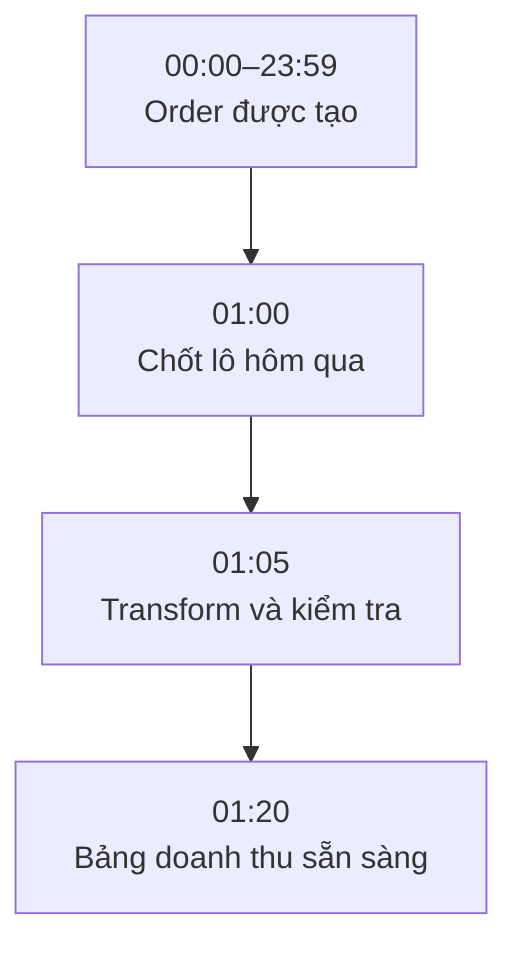
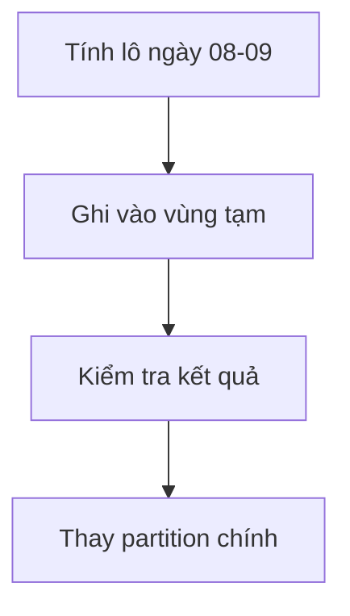

Team tài chính cần doanh thu ngày hôm qua trước 7 giờ sáng. Họ không cần con số đổi sau từng giây; họ cần kết quả đầy đủ và có thể đối soát.

**Batch Processing** (xử lý theo lô) gom một tập data có giới hạn rồi xử lý trong một lần chạy. Lô có thể là order trong một ngày, một file vừa nhận hoặc các row mới kể từ lần chạy trước.



## Một lô có ranh giới

Job nhận hai tham số:

```text
start_time = 2026-09-08 00:00:00
end_time   = 2026-09-09 00:00:00
```

```sql
SELECT * FROM orders
WHERE created_at >= TIMESTAMP '2026-09-08 00:00:00'
  AND created_at <  TIMESTAMP '2026-09-09 00:00:00';
```

Khoảng này gồm `start_time` nhưng không gồm `end_time`, nên order đúng lúc nửa đêm không bị tính ở cả hai ngày.

| order_id | created_at | amount |
| --- | --- | ---: |
| ORD-1042 | 2026-09-08 12:02:10 | 120000 |
| ORD-1043 | 2026-09-08 12:07:31 | 85000 |

Job có thể tổng hợp thành:

| order_date | total_orders | revenue |
| --- | ---: | ---: |
| 2026-09-08 | 2 | 205000 |

## Full Load và Incremental Load

**Full Load** đọc toàn bộ data mỗi lần. Nó đơn giản và có thể đủ tốt khi bảng nhỏ. **Incremental Load** chỉ đọc phần mới hoặc thay đổi, nhanh hơn khi lịch sử lớn nhưng dễ bỏ sót update.

| Cách đọc | Ưu điểm | Rủi ro |
| --- | --- | --- |
| Full Load | Dễ hiểu và tái tạo | Chậm khi data lớn |
| Incremental Load | Chỉ xử lý phần cần | Có thể tạo khoảng trống |

Nên bắt đầu bằng cách đơn giản nhất đáp ứng thời gian chạy.

## Data đến muộn

Thanh toán của ngày 8 có thể đến vào sáng ngày 9 vì hệ thống nguồn bị chậm. Pipeline có thể đọc lại ba ngày gần nhất hoặc cho phép chạy lại một ngày cụ thể. Output phải có Idempotency để lần chạy lại không cộng doanh thu lần thứ hai.

## Thất bại giữa chừng

Nếu job ghi 600 trong 1.000 row rồi dừng, người dùng có thể thấy một ngày chưa hoàn tất. Cách an toàn hơn là ghi vào vùng tạm, kiểm tra rồi mới thay partition chính.



Batch phù hợp khi người dùng chấp nhận data trễ vài phút, vài giờ hoặc một ngày, input đến theo file, hoặc kết quả cần chốt theo kỳ. Nếu tài xế cần nhận order mới trong vài giây, đợi batch mỗi giờ là quá chậm. Nhưng với nhiều report và đối soát, Batch vẫn rõ ràng, dễ vận hành và đủ nhanh.
