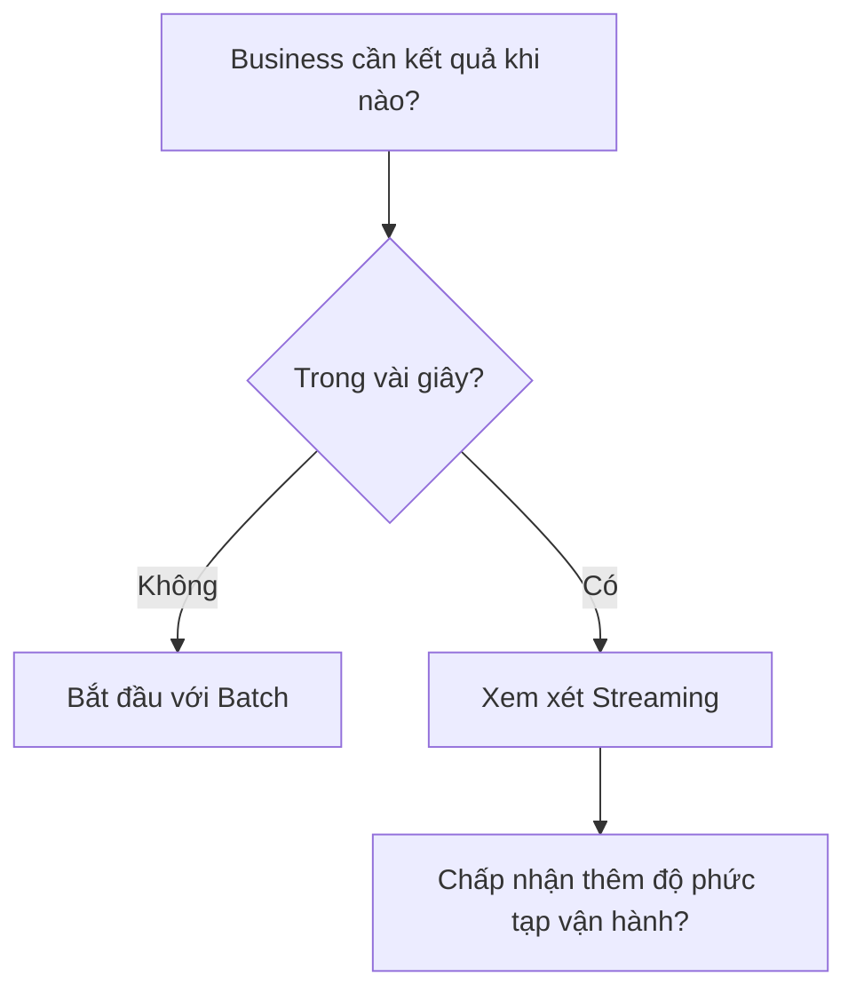

Report tài chính cần chốt mỗi ngày, còn hệ thống phát hiện thanh toán bất thường cần phản ứng trong vài giây. Cả hai xử lý data, nhưng yêu cầu về thời gian khác nhau.

**Batch Processing** xử lý một tập data hữu hạn. **Stream Processing** (xử lý luồng data liên tục) xử lý các event khi chúng tiếp tục đến.

| Câu hỏi | Batch | Streaming |
| --- | --- | --- |
| Input có kết thúc? | Có ranh giới rõ | Tiếp tục đến |
| Kết quả cập nhật | Theo lịch | Liên tục |
| Độ trễ | Phút, giờ, ngày | Giây hoặc thấp hơn |
| Xử lý data đến muộn | Chạy lại partition | Watermark và update kết quả |
| Vận hành | Thường đơn giản hơn | Cần quản lý state, order, replay |

## Cùng một bài toán, hai cách

Batch gom order trong cửa sổ năm phút rồi tính tổng. Streaming cập nhật tổng khi từng event đến. Sau năm phút, hai output có thể giống nhau; khác biệt là thời điểm nhìn thấy kết quả và cách hệ thống đạt đến đó.

Streaming không đồng nghĩa data luôn đúng ngay lập tức. Event có thể đến trễ, sai thứ tự hoặc được gửi lại. Hệ thống phải quyết định bao lâu sẽ chờ và khi nào cập nhật kết quả cũ.

## Chọn theo yêu cầu thật

Nếu người dùng xem dashboard mỗi sáng, pipeline mỗi đêm có thể đủ. Nếu fraud decision phải chặn giao dịch trước khi hoàn tất, batch một giờ không đáp ứng được. Đừng chọn Streaming chỉ vì volume lớn: một batch engine vẫn xử lý được data rất lớn. Lý do chính thường là latency và nhu cầu phản ứng liên tục.

Nhiều hệ thống dùng cả hai: Streaming cho tín hiệu sớm, Batch để đối soát và sửa lịch sử. Hãy bắt đầu với phương án đơn giản đáp ứng SLA rồi chỉ thêm độ phức tạp khi giá trị của kết quả sớm đủ lớn.
