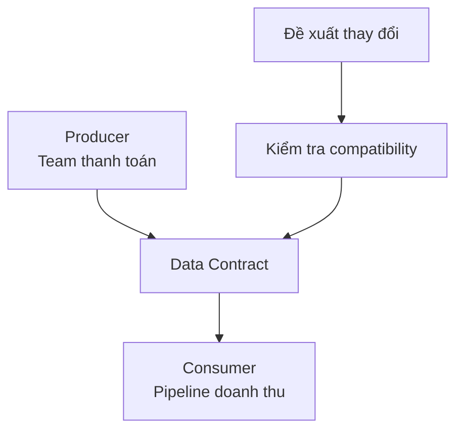

Team thanh toán đổi `amount` từ cent sang dollar mà không báo. Pipeline vẫn chạy, nhưng doanh thu nhỏ đi 100 lần.

**Data Contract** (cam kết về data giữa producer và consumer) ghi lại data nào được cung cấp, ý nghĩa của nó, mức chất lượng mong đợi và cách thay đổi được quản lý.

```yaml
name: payment_completed
owner: payments-team
fields:
  payment_id: {type: string, required: true}
  order_id: {type: string, required: true}
  amount_cents: {type: integer, minimum: 0}
  currency: {type: string, allowed: [SGD]}
```

Contract có thể gồm:

- Schema và field bắt buộc.
- Grain, key và ý nghĩa business.
- Freshness hoặc availability đã hứa.
- Quy tắc quality quan trọng.
- Owner, consumer và quy trình thay đổi.



## Contract không chỉ là schema

Hai field cùng type `integer` vẫn có thể mang đơn vị khác nhau. Kiểm tra schema không phát hiện cent đổi thành dollar. Contract cần ghi ý nghĩa mà code và con người có thể kiểm tra.

## Ai chịu trách nhiệm?

Producer chịu trách nhiệm giữ lời hứa hoặc thông báo thay đổi. Consumer chịu trách nhiệm dùng đúng mục đích và nêu dependency quan trọng. Data team hỗ trợ công cụ, checks và cách phối hợp; họ không thể tự định nghĩa data của mọi domain.

Không cần viết contract dài cho mọi bảng tạm. Hãy dùng nó ở ranh giới giữa team, nơi thay đổi có thể âm thầm làm hỏng downstream. Contract tốt làm thay đổi có chủ đích; nó không đóng băng hệ thống mãi mãi.
