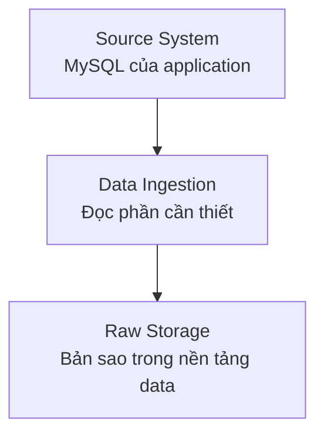

Data Pipeline đầu tiên cần lấy đơn hàng từ MySQL. Đọc một bảng nghe đơn giản, nhưng database này đang phục vụ khách đặt món. Một query nặng có thể làm application chậm.

**Data Ingestion** (thu thập và đưa data vào hệ thống) là phần đưa data từ Source System đến nơi data có thể được lưu và xử lý tiếp.



## Lần đầu và những lần sau

Lần đầu pipeline chạy, nó có thể cần ba năm lịch sử. Đây là **Initial Load** (lần tải ban đầu). Sau đó, **Incremental Load** (tải phần tăng thêm) chỉ lấy row mới hoặc vừa thay đổi.

| Lần chạy | Điều kiện đọc | Số row ví dụ |
| --- | --- | ---: |
| Initial Load | Toàn bộ `orders` | 12,400,000 |
| 12:15 | `updated_at` từ 12:00 đến 12:15 | 3,842 |
| 12:30 | `updated_at` từ 12:15 đến 12:30 | 4,106 |

Initial Load cần giới hạn tốc độ hoặc đọc từ replica để tránh gây tải lớn. Incremental Load cần một field đáng tin để không bỏ sót thay đổi.

## Ba cách lấy phần thay đổi

Cách đơn giản là query theo timestamp:

```sql
SELECT * FROM orders
WHERE updated_at >= :start_time
  AND updated_at < :end_time;
```

Đối tác cũng có thể gửi file mỗi ngày, hoặc dịch vụ thanh toán cung cấp API phân trang. Pipeline cần nhớ file hay page nào đã nhận.

Với database thay đổi liên tục, Change Data Capture có thể đọc nhật ký Insert, Update và Delete. Cách này bắt thay đổi tốt hơn query timestamp, nhưng vận hành phức tạp hơn.

## Giữ dấu vết của nguồn

| Field | Ý nghĩa |
| --- | --- |
| `order_id` | Khoá của row ở nguồn |
| `source_updated_at` | Thời điểm row đổi trong application |
| `ingested_at` | Thời điểm nền tảng data nhận row |
| `source_system` | Row đến từ hệ thống nào |

`source_updated_at` và `ingested_at` trả lời hai câu khác nhau. Khoảng cách giữa chúng giúp phát hiện data đến trễ.

## Delete dễ bị bỏ quên

Nếu application xoá `ORD-1042`, query theo `updated_at` không còn row để đọc. Bản sao trong warehouse vẫn giữ order như thể nó tồn tại.

Source System có thể dùng `deleted_at`, phát một sự kiện xoá hoặc để CDC đọc thao tác Delete. Data Engineer cần hỏi từ đầu: row có bị xoá không, và downstream mong muốn điều gì khi nó bị xoá?

## Đừng làm hỏng Source System

Rủi ro phổ biến là query toàn bảng giờ cao điểm, mở quá nhiều connection, vượt API rate limit hoặc Retry liên tục khi nguồn đang lỗi. Pipeline cần pagination, giới hạn tài nguyên và backoff phù hợp.

Với bảng nhỏ cập nhật theo giờ, query timestamp có thể đủ. Với hàng triệu thay đổi hoặc cần bắt Delete nhanh, CDC có thể phù hợp hơn. Với đối tác chỉ gửi file cuối ngày, không cần biến nó thành Streaming.

Data Ingestion tốt đưa đủ thay đổi đến đích trong thời gian đã hứa, kiểm tra được, và không làm ảnh hưởng hệ thống nguồn.
