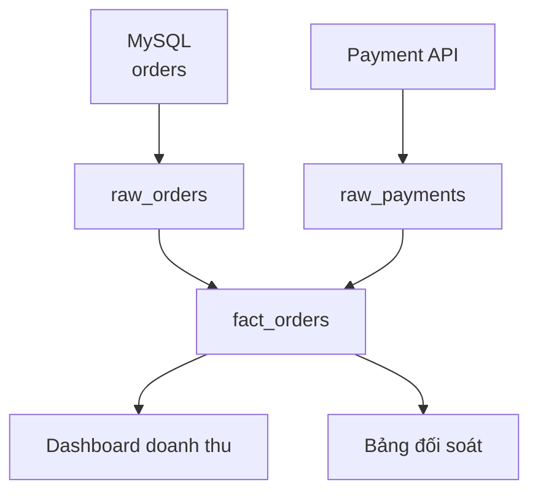

Dashboard doanh thu giảm 30%. Bảng đầu ra có năm upstream table và nhiều pipeline. Data Engineer cần biết thay đổi bắt đầu ở đâu và còn ai bị ảnh hưởng.

**Data Lineage** (quan hệ nguồn gốc và đường đi của data) mô tả dataset được tạo từ đâu, qua bước nào và được output nào sử dụng.

## Lineage trả lời hai hướng

**Upstream** của `fact_orders` cho biết input nào tạo ra nó. **Downstream** cho biết bảng, dashboard hoặc model nào phụ thuộc vào nó.

Khi `payment_status` đổi type, downstream lineage giúp xác định phạm vi ảnh hưởng trước khi deploy. Khi dashboard sai, upstream lineage thu hẹp nơi cần điều tra.

Lineage có nhiều mức chi tiết:

| Mức | Ví dụ | Dùng khi |
| --- | --- | --- |
| System | MySQL → Warehouse → BI | Nhìn kiến trúc tổng thể |
| Dataset | `raw_orders` → `fact_orders` | Điều tra pipeline |
| Column | `payments.amount` → `fact_orders.revenue` | Phân tích thay đổi field |

Lineage có thể thu tự động từ SQL và job, nhưng dynamic SQL hoặc thao tác thủ công dễ tạo khoảng trống. Owner vẫn cần kiểm tra những đường quan trọng.

Một sơ đồ đẹp nhưng đã cũ không giúp xử lý incident. Lineage nên gắn với metadata đang chạy, thời điểm cập nhật và link đến job thật. Bắt đầu ở dataset quan trọng thay vì cố vẽ toàn bộ công ty cùng lúc.
