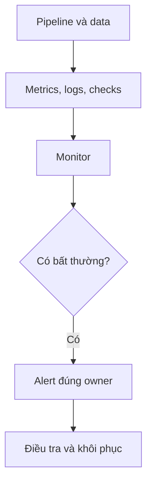

Data Quality check biết `order_id` không được rỗng. Nhưng ai phát hiện pipeline chưa chạy, data trễ ba giờ hoặc số order giảm bất thường?

**Data Observability** (khả năng quan sát hệ thống data) là khả năng hiểu trạng thái của pipeline và data từ các tín hiệu mà hệ thống tạo ra.

## Quan sát cả job lẫn data

| Tín hiệu | Câu hỏi |
| --- | --- |
| Freshness | Data mới nhất đến từ khi nào? |
| Volume | Số row có khác thường không? |
| Distribution | Giá trị và tỷ lệ có đổi mạnh không? |
| Schema | Field nào vừa thêm, xoá hoặc đổi type? |
| Lineage | Output nào bị ảnh hưởng bởi lỗi upstream? |
| Job metrics | Job có chạy, chậm hay Retry nhiều không? |



Một freshness monitor có thể kiểm tra:

```text
max(ingested_at) phải cách hiện tại < 30 phút
```

Nếu source vốn chỉ gửi file lúc 6 giờ sáng, rule 30 phút sẽ báo động giả cả ngày. Monitor phải dựa trên nhịp data đã hứa.

## Alert cần dẫn đến hành động

“Table failed” chưa đủ. Alert nên có dataset, partition, giá trị thực tế, ngưỡng, upstream gần nhất và owner. Cũng cần phân biệt warning với sự cố chặn người dùng.

Observability không tự đảm bảo Data Quality. Nó kết hợp checks, logs, metrics và lineage để phát hiện rồi khoanh vùng vấn đề nhanh hơn. Bắt đầu với các bảng quan trọng và tín hiệu gắn với cam kết thật; quá nhiều alert không có owner chỉ tạo tiếng ồn.
