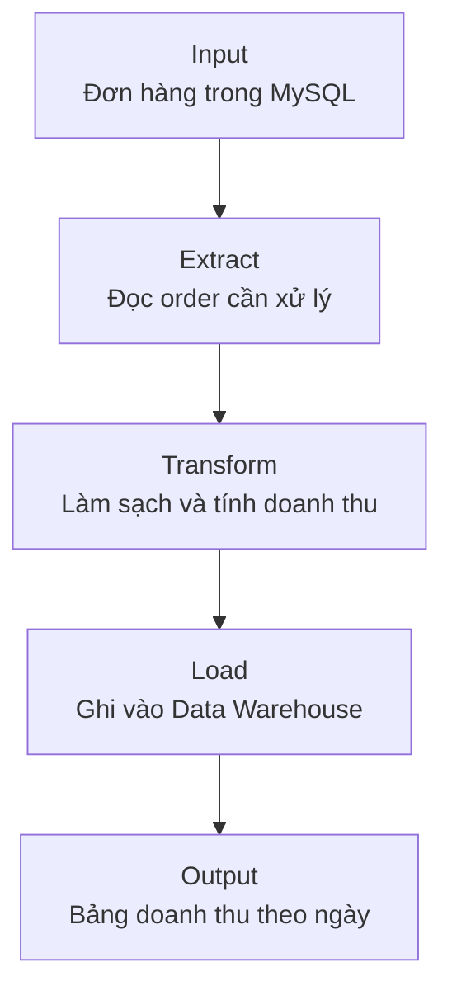

Mỗi đêm, một nhân viên tải file đơn hàng, sửa vài cột trong spreadsheet rồi gửi report doanh thu. Công việc này tạo ra kết quả, nhưng phụ thuộc vào một người nhớ làm đúng từng bước.

Khi các bước được nối lại thành một quy trình có thể chạy lặp lại, chúng ta có một **Data Pipeline** (luồng xử lý đưa data từ đầu vào đến đầu ra).



Pipeline có thể chỉ là một chương trình Python và một câu SQL. Điều quan trọng là data đi qua các bước có input, output và cách chạy rõ ràng.

## Theo dấu một order

MySQL có row sau:

| order_id | status | total_amount | updated_at |
| --- | --- | ---: | --- |
| ORD-1042 | delivered | 120000 | 2026-09-08 12:32:00 |

Pipeline đọc row, kiểm tra các field bắt buộc, chuẩn hoá thời gian rồi ghi vào bảng dành cho report:

| order_id | order_date | is_delivered | revenue |
| --- | --- | --- | ---: |
| ORD-1042 | 2026-09-08 | true | 120000 |

Dashboard đọc bảng này để tính tổng doanh thu. Nếu định nghĩa `revenue` thay đổi, logic được sửa tại một nơi thay vì để từng dashboard tự đoán.

## Năm câu hỏi để hiểu một pipeline

| Câu hỏi | Trong ví dụ này |
| --- | --- |
| Input là gì? | Bảng `orders` trong MySQL |
| Output là gì? | Bảng `fact_orders` trong Data Warehouse |
| Khi nào chạy? | Mỗi 15 phút |
| Mỗi lần xử lý phần nào? | Order mới hoặc vừa cập nhật |
| Ai dùng kết quả? | Team vận hành và tài chính |

Nếu chưa trả lời được năm câu này, việc đọc code hay chọn công cụ thường chỉ làm hệ thống khó hiểu hơn.

## Pipeline chạy lần sau như thế nào?

Một pipeline lặp lại phải biết data nào đã xử lý. Nếu lần trước đọc đến 12:15, lần sau có thể đọc từ 12:15 đến 12:30. Tuy nhiên, update có thể đến muộn. Pipeline thường đọc chồng một khoảng nhỏ rồi dùng `order_id` để cập nhật row đã có.

```text
Lần 1: 12:00 → 12:15
Lần 2:         12:10 → 12:30
               ↑ đọc chồng 5 phút
```

Cách này chỉ an toàn khi chạy lại không nhân đôi output. Đó là Idempotency, một chủ đề riêng trong phần vận hành.

## Chạy thành công vẫn có thể cho data sai

Chương trình kết thúc không có error chưa đảm bảo output dùng được:

- API trả danh sách rỗng do token hết hạn.
- JOIN làm một order xuất hiện hai lần.
- Pipeline chỉ lấy 12 giờ đầu ngày nhưng vẫn ghi bảng.
- Field đổi tên, code thay giá trị thiếu bằng `0` và che mất lỗi.

Pipeline cần ghi lại số row đọc, số row ghi, khoảng data đã xử lý và kiểm tra Data Quality trước khi công bố output.

## Khi nào chưa cần pipeline phức tạp?

Nếu một file được xử lý mỗi tháng và tác động thấp, một script có hướng dẫn rõ có thể đã đủ. Khi data cập nhật thường xuyên, nhiều người phụ thuộc vào output hoặc lỗi gây quyết định sai, pipeline nên được tự động hoá và theo dõi.

Hãy giữ mental model đơn giản: pipeline nhận input, thực hiện các bước có thể kiểm tra, rồi tạo output cho một người dùng cụ thể.
