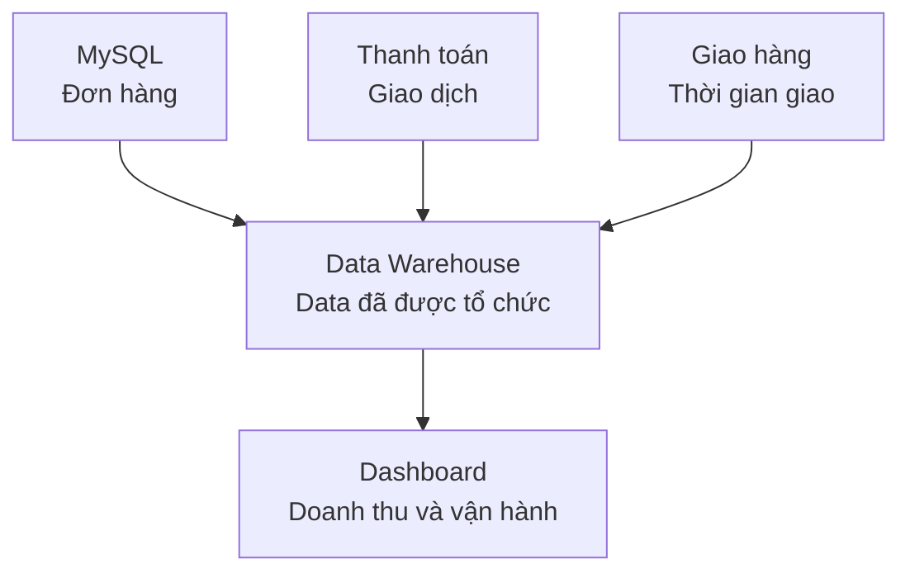

Ứng dụng đã lưu đơn hàng trong MySQL. Nếu data đã nằm trong database, tại sao công ty còn cần thêm một nơi khác?

MySQL đang nhận đơn và cập nhật trạng thái giao hàng. Một query quét vài năm lịch sử để tính doanh thu có thể tranh tài nguyên với application.

**Data Warehouse** (kho dữ liệu) là hệ thống lưu trữ được thiết kế chủ yếu cho phân tích. Nó gom data từ nhiều Source System, giữ lịch sử và tổ chức data để những câu query lớn dễ viết và chạy hiệu quả hơn.



## Hai workload khác nhau

Database của application xử lý nhiều thao tác nhỏ và liên tục. Data Warehouse thường đọc rất nhiều row để tổng hợp:

```sql
SELECT restaurant_id, SUM(net_amount) AS revenue
FROM fact_orders
WHERE order_date >= DATE '2026-08-01'
  AND order_date < DATE '2026-09-01'
GROUP BY restaurant_id;
```

| Nhu cầu | Database application | Data Warehouse |
| --- | --- | --- |
| Tạo một order | Công việc chính | Không phải công việc chính |
| Cập nhật trạng thái | Công việc chính | Nhận bản sao sau đó |
| Tổng hợp hàng triệu order | Có thể ảnh hưởng app | Được thiết kế cho loại query này |
| Ghép nhiều hệ thống | Khó và tăng phụ thuộc | Công việc phổ biến |
| Giữ lịch sử dài hạn | Tuỳ vận hành | Thường cần thiết |

Một Data Warehouse vẫn là một dạng database. Điểm khác nằm ở workload mà nó phục vụ.

## Tổ chức lại data

Ở nguồn, một order nằm trong `orders`, `payments`, `deliveries` và `restaurants`. Warehouse có thể tạo `fact_orders` với một row cho mỗi order:

| order_id | order_date | restaurant_id | net_amount | delivery_minutes |
| --- | --- | --- | ---: | ---: |
| ORD-1042 | 2026-09-08 | RES-18 | 120000 | 30 |
| ORD-1043 | 2026-09-08 | RES-07 | 85000 | 51 |

Thông tin nhà hàng nằm trong `dim_restaurants`:

| restaurant_id | restaurant_name | area |
| --- | --- | --- |
| RES-18 | Cơm Nhà | Tampines |
| RES-07 | Bếp Nhỏ | Bedok |

Nhiều report có thể dùng chung định nghĩa doanh thu thay vì tự nối các bảng nguồn theo nhiều cách.

## Warehouse không tự làm data đúng

Pipeline vẫn có thể bỏ sót order, nhân đôi thanh toán hoặc ghép sai nhà hàng. Warehouse cung cấp nơi phù hợp để lưu và query; Data Engineer vẫn cần Transformation và Data Quality.

Nó cũng có thể trở thành nơi chứa nhiều bảng gần giống nhau mà không ai biết bảng nào còn được cập nhật. Metadata, Data Lineage và Data Catalog giúp giải quyết vấn đề này.

## Khi nào cần?

Một cửa hàng nhỏ có thể query từ bản sao PostgreSQL. Data Warehouse có giá trị khi query phân tích ảnh hưởng application, cần kết hợp nhiều nguồn, giữ lịch sử dài hoặc nhiều team cần dùng chung bảng và định nghĩa.

Source System lưu data để hoạt động kinh doanh diễn ra. Data Warehouse tổ chức bản sao của data đó để phân tích an toàn hơn.
