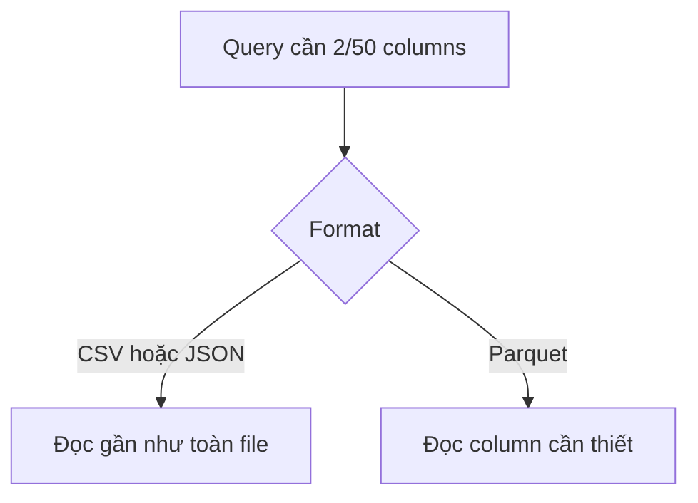

Cùng một triệu order có thể được lưu bằng CSV, JSON hoặc Parquet. Nội dung business giống nhau, nhưng kích thước và cách engine đọc rất khác.

**File Format** (định dạng file) quy định data được mã hoá và tổ chức trong một file.

| Format | Tổ chức | Điểm mạnh | Hạn chế |
| --- | --- | --- | --- |
| CSV | Text theo row | Đơn giản, mở ở nhiều nơi | Type và nested data yếu |
| JSON | Text theo object | Linh hoạt, nested tự nhiên | Lặp tên field, file lớn |
| Parquet | Binary theo column | Nén và analytical scan tốt | Khó đọc trực tiếp bằng mắt |

## Row và column

Report chỉ cần `restaurant_id` và `amount` trong bảng 50 field. CSV thường phải đọc cả row. Parquet tổ chức theo column nên engine có thể bỏ qua các column không dùng.

Parquet còn giữ type và statistics theo nhóm row, giúp bỏ qua phần không phù hợp filter. Đây là lý do nó thường dùng cho analytical storage.

## Format không sửa data quality

CSV có thể chứa dấu phẩy trong text, encoding khác nhau hoặc ngày không thống nhất. JSON linh hoạt nên hai row có thể mang shape khác nhau. Parquet có schema nhưng nhiều file trong cùng dataset vẫn có thể khác schema.

CSV phù hợp để trao đổi nhỏ và tương thích rộng. JSON phù hợp event/API có cấu trúc lồng. Parquet phù hợp scan phân tích lớn. Có thể nhận JSON ở ingestion rồi chuyển sang Parquet sau khi làm sạch; không cần ép một format cho mọi giai đoạn.
