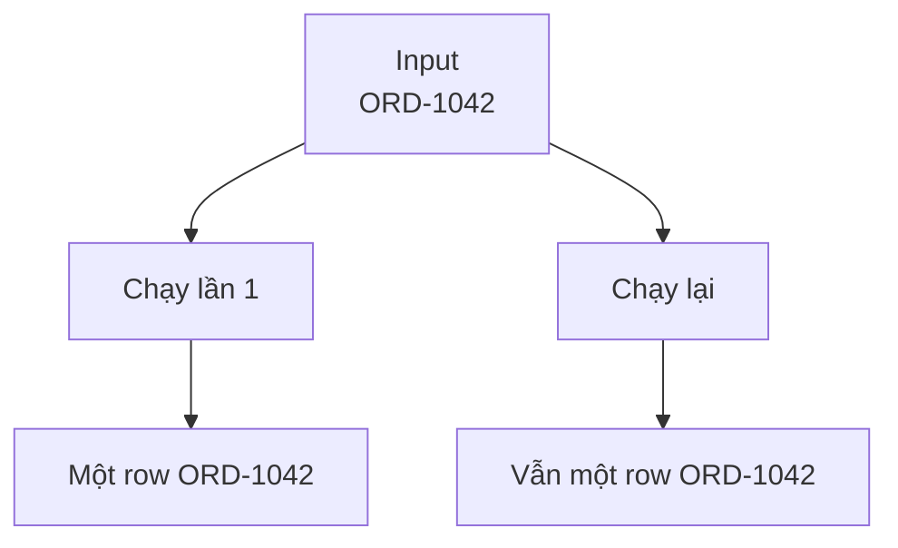

Pipeline đã ghi xong 900 order thì mất kết nối. Bạn không biết 100 order cuối đã được ghi hay chưa, nên chạy lại cả lô. Nếu job dùng `INSERT`, bảng có thể xuất hiện duplicate.

**Idempotency** (khả năng chạy lại mà không tạo thêm kết quả ngoài ý muốn) nghĩa là xử lý cùng input một hay nhiều lần vẫn đưa hệ thống đến cùng trạng thái.



## Dùng business key để nhận diện row

`order_id` cho biết hai lần nhận được có phải cùng một order hay không.

| order_id | status | amount |
| --- | --- | ---: |
| ORD-1042 | paid | 120000 |

Thay vì luôn thêm row, pipeline có thể **Upsert**: thêm khi key chưa tồn tại, cập nhật khi key đã có.

```sql
INSERT INTO orders (order_id, status, amount)
VALUES ('ORD-1042', 'paid', 120000)
ON CONFLICT (order_id) DO UPDATE
SET status = EXCLUDED.status,
    amount = EXCLUDED.amount;
```

Với bảng tổng hợp theo ngày, một cách khác là tính lại toàn bộ partition rồi thay thế nguyên khối. Xoá rồi ghi lại cần transaction hoặc vùng tạm; nếu job dừng sau bước xoá, người dùng sẽ thấy data trống.

## Không phải lúc nào key cũng rõ

Một payment retry có thể tạo nhiều transaction hợp lệ cho cùng order. Dùng `order_id` làm key sẽ ghi đè nhầm. Key phải phản ánh grain: nếu mỗi row là một lần thanh toán, `payment_id` mới phù hợp.

Idempotency cần được test bằng cách cố tình chạy cùng lô hai lần và so cả số row lẫn metric. Đây là nền tảng để Retry và Backfill an toàn.
