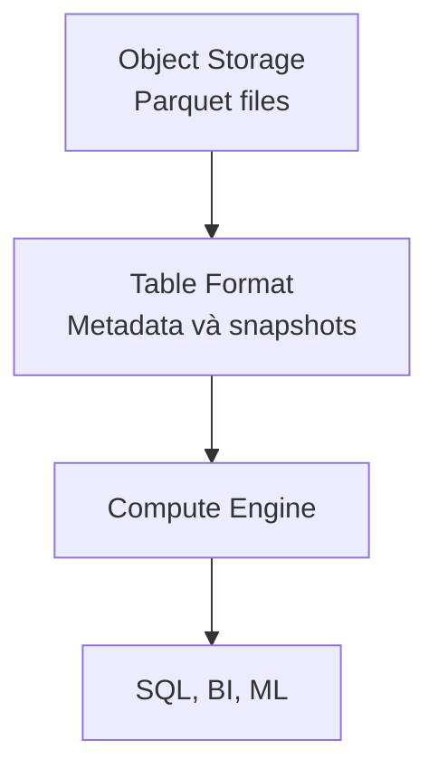

Data Lake lưu Parquet rẻ và linh hoạt, nhưng nhiều job cùng sửa file dễ làm người đọc thấy trạng thái dở dang. Team cũng cần Update, Delete, schema evolution và lịch sử snapshot.

**Lakehouse** là cách xây khả năng quản lý table kiểu Data Warehouse trên storage của Data Lake, thường bằng object storage, table format và một hay nhiều compute engine.

## Table không chỉ là một thư mục file

Table format theo dõi file nào thuộc snapshot hiện tại. Writer tạo file mới rồi commit metadata; reader thấy snapshot trước hoặc sau commit, không thấy nửa chừng.

| Khả năng | Thư mục Parquet | Table được quản lý |
| --- | --- | --- |
| Atomic commit | Khó | Có cơ chế commit |
| Update/Delete | Tự viết lại và theo dõi | Được table format hỗ trợ |
| Time travel | Không có sẵn | Đọc snapshot cũ |
| Schema evolution | Dễ không nhất quán | Có rule và metadata |

Lakehouse không phải một sản phẩm duy nhất. Iceberg, Delta Lake và Hudi là table format với thiết kế khác nhau; Spark, Flink hoặc query engine là compute.

## Khi nào cần?

Lakehouse hữu ích khi data lớn nằm trên object storage, nhiều workload cần dùng chung table và team cần transaction hoặc snapshot. Nếu warehouse hiện tại đáp ứng chi phí, performance và governance, chuyển kiến trúc chỉ để có tên mới hiếm khi tạo giá trị.

Sự linh hoạt cũng mang thêm việc vận hành: compact small files, dọn snapshot cũ, chọn partition, kiểm soát catalog và compatibility giữa engine. Hãy đánh giá những trách nhiệm này cùng lợi ích storage mở.
