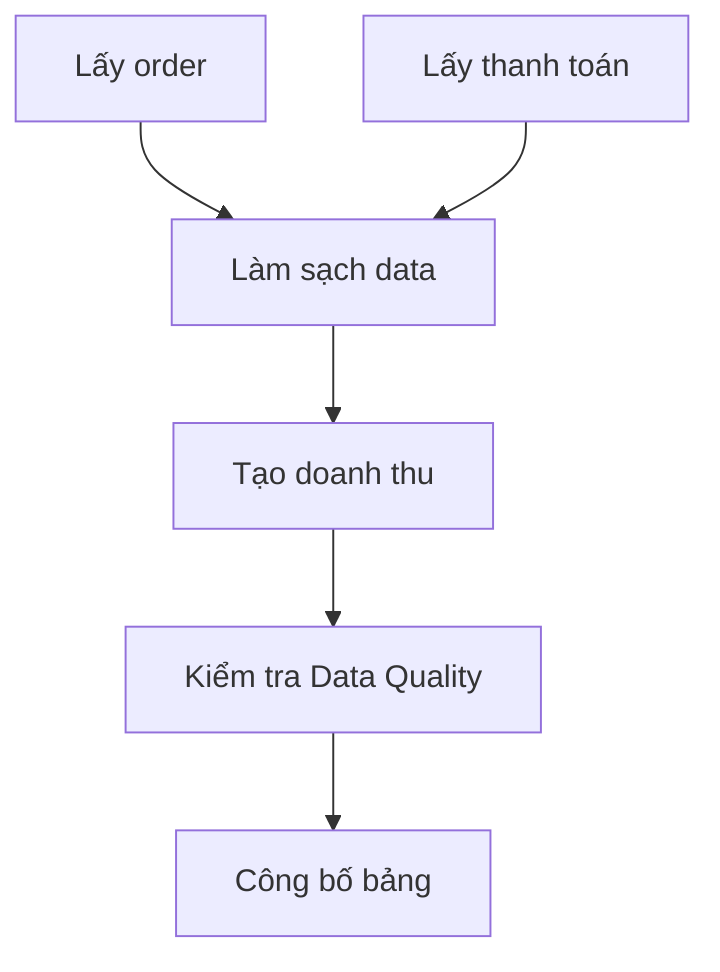

Một script lấy order có thể chạy bằng `cron`. Nhưng report doanh thu còn cần thanh toán, thông tin nhà hàng và bước kiểm tra. Nếu mỗi script có lịch riêng, report có thể chạy trước khi data thanh toán sẵn sàng.

**Data Orchestration** (điều phối công việc data) quản lý khi nào job chạy, job nào phải đợi job nào, trạng thái từng lần chạy và cách phản ứng khi có lỗi.



## Schedule chưa thể hiện dependency

| Giờ | Job | Thời gian thường chạy |
| --- | --- | ---: |
| 01:00 | Lấy order | 10 phút |
| 01:00 | Lấy thanh toán | 20 phút |
| 01:30 | Tạo doanh thu | 15 phút |

Một hôm API thanh toán chậm và job mất 45 phút. Job doanh thu vẫn bắt đầu lúc 01:30, đọc data chưa đủ và tạo report thấp hơn thực tế.

Orchestrator thể hiện dependency trực tiếp: doanh thu chỉ chạy khi cả hai job upstream thành công.

## Mỗi lần chạy có trạng thái

```text
scheduled → running → success
                    ↘ failed → retrying
```

Trạng thái giúp trả lời job đã chạy chưa, đang chờ gì, lỗi ở bước nào và thử lại bao nhiêu lần. Nếu chỉ có nhiều script và log rời rạc, Data Engineer phải tự ghép câu trả lời khi incident xảy ra.

## Ngày xử lý khác giờ chạy

Job chạy lúc 01:00 ngày 9 thường xử lý ngày 8:

| Thời điểm chạy | Khoảng data xử lý |
| --- | --- |
| 2026-09-09 01:00 | 2026-09-08 00:00 → 2026-09-09 00:00 |
| Chạy lại 2026-09-10 14:00 | Vẫn là khoảng ngày 8 |

Job nên nhận khoảng data thay vì dùng `NOW()` để đoán. Nhờ vậy Retry và Backfill tạo đúng kết quả dù chạy muộn.

## Orchestrator không sửa được job thiếu an toàn

Orchestrator có thể Retry, nhưng nếu task luôn `INSERT` toàn bộ data, Retry tạo duplicate. Nó báo job thành công nhưng không biết doanh thu đúng nếu thiếu quality check.

Một job nên nhận input rõ, chạy lại an toàn, trả lỗi khi output chưa hoàn tất và chỉ công bố data sau kiểm tra.

Một pipeline duy nhất có thể bắt đầu bằng cron. Orchestrator có ích khi có nhiều dependency, nhiều lịch, nhu cầu Retry/Backfill hoặc cần lịch sử từng lần chạy. Airflow, Dagster và Prefect là ví dụ công cụ; trước tiên hãy vẽ đúng dependency và trạng thái thất bại.
