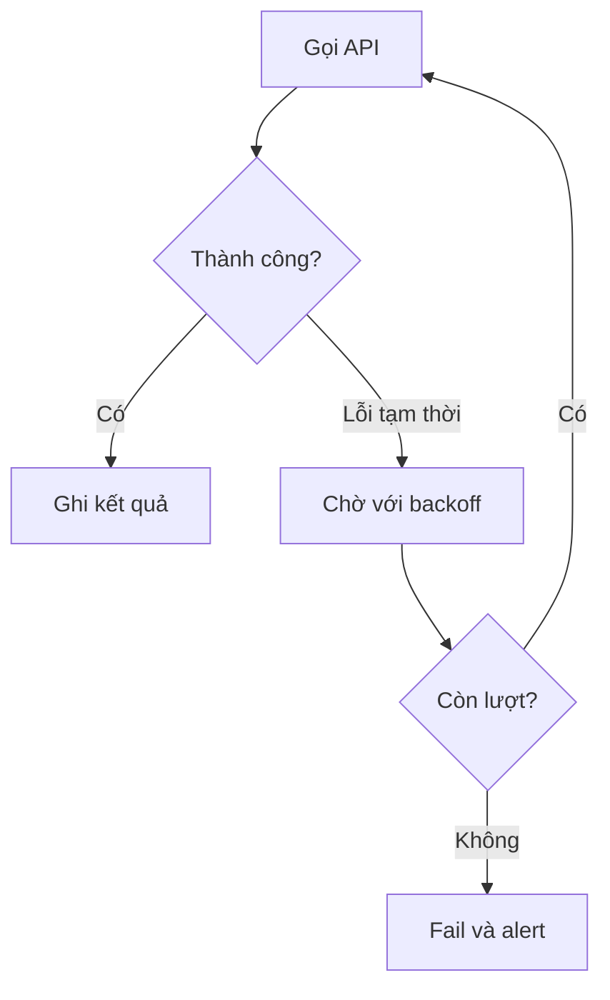

API thanh toán trả lỗi `503 Service Unavailable`. Nếu pipeline dừng ngay, report bị thiếu. Nếu gọi lại liên tục, nó có thể làm dịch vụ đang yếu càng quá tải.

**Retry** (thử lại) là chạy lại một thao tác sau khi nó thất bại vì một vấn đề có khả năng tạm thời.

## Lỗi nào nên thử lại?

| Lỗi | Retry? | Lý do |
| --- | --- | --- |
| Timeout mạng | Có, với giới hạn | Kết nối có thể phục hồi |
| HTTP 429 | Có, theo `Retry-After` | Dịch vụ yêu cầu giảm tốc |
| HTTP 503 | Có | Dịch vụ tạm thời chưa sẵn sàng |
| Sai password | Không | Chờ không sửa được cấu hình |
| SQL sai cú pháp | Không | Code phải được sửa |
| Schema thiếu field bắt buộc | Thường không | Cần điều tra contract |

## Chờ lâu dần giữa các lần

```text
Lần 1 thất bại → chờ 2 giây
Lần 2 thất bại → chờ 4 giây
Lần 3 thất bại → chờ 8 giây
Sau giới hạn     → đánh dấu failed
```

Đây là **Exponential Backoff** (thời gian chờ tăng dần). Thêm một khoảng ngẫu nhiên nhỏ giúp nhiều worker không gọi lại cùng lúc.



Một timeout không cho biết request trước đã được xử lý hay chưa. Retry thao tác tạo payment có thể thu tiền hai lần. Hệ thống cần idempotency key hoặc kiểm tra trạng thái trước khi thử lại.

Retry nên có giới hạn, ghi lại nguyên nhân và cuối cùng tạo alert có người chịu trách nhiệm. Nó giúp vượt qua lỗi tạm thời, không thay thế việc sửa lỗi lâu dài.
