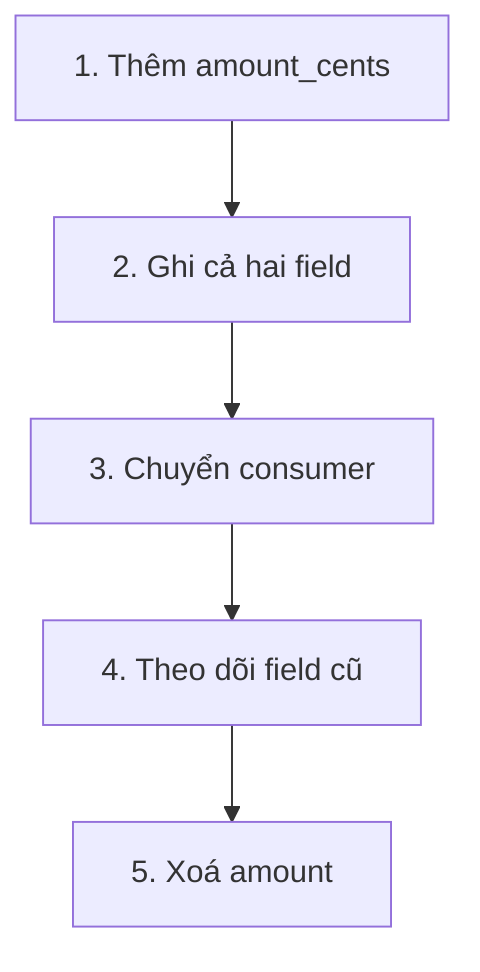

Application cần thêm `delivery_method` vào order. Một tháng sau, team muốn đổi `total_amount` từ số nguyên sang object gồm amount và currency. Hai thay đổi có mức rủi ro khác nhau.

**Schema Evolution** (quá trình schema thay đổi theo thời gian) là cách thêm, bỏ hoặc sửa cấu trúc data trong khi quản lý compatibility với consumer.

| Thay đổi | Rủi ro thường gặp |
| --- | --- |
| Thêm field optional | Consumer cũ thường bỏ qua được |
| Thêm field required | Row cũ và producer cũ không có giá trị |
| Đổi tên field | Consumer cũ thấy field biến mất |
| Đổi type | Query hoặc parser có thể lỗi |
| Xoá field | Mọi dependency phải chuyển trước |

## Thay đổi theo nhiều bước

Để đổi `amount` thành `amount_cents`, team có thể:

Trong giai đoạn chuyển tiếp:

| payment_id | amount | amount_cents |
| --- | ---: | ---: |
| PAY-88 | 1200.00 | 120000 |

Data Contract ghi thời hạn và owner. Lineage tìm consumer. Quality check xác nhận hai field tương đương.

## Data lịch sử vẫn tồn tại

Schema mới không tự sửa file Parquet cũ. Reader có thể phải hiểu cả version cũ và mới, hoặc team Backfill lịch sử sang schema mới. Cần test với data từ nhiều thời điểm, không chỉ sample mới nhất.

Schema registry và table format có thể kiểm tra một số compatibility rule, nhưng không biết thay đổi ý nghĩa business. Đổi `status=done` thành `status=delivered` vẫn cùng type string và vẫn có thể phá metric.

Schema sẽ thay đổi vì sản phẩm thay đổi. Mục tiêu là cho producer tiến lên mà consumer có thời gian phát hiện, chuyển đổi và xác nhận kết quả.
