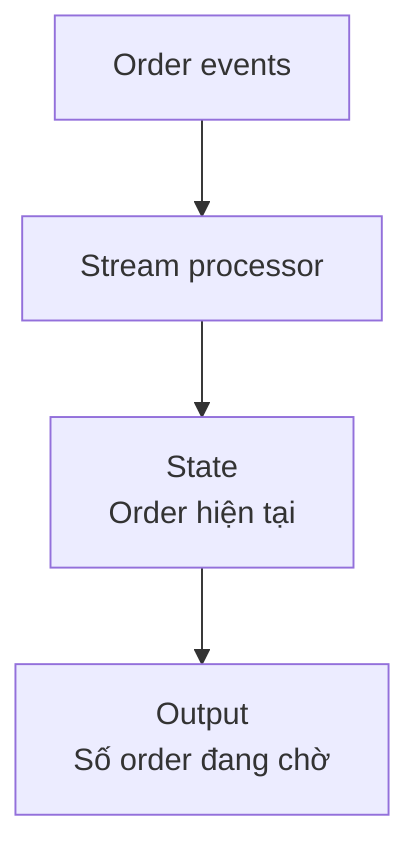

Mỗi khi order đổi trạng thái, application phát một event. Team vận hành muốn số order đang chờ tài xế được cập nhật trong vài giây.

**Stream Processing** (xử lý luồng data liên tục) đọc một dòng event không có điểm kết thúc đã biết và cập nhật output khi event đến.



Một event có thể là:

```json
{"event_id":"EV-91","order_id":"ORD-1042","status":"driver_assigned","occurred_at":"2026-09-08T12:08:00+08:00"}
```

## Event time và processing time

**Event Time** là lúc sự việc xảy ra. **Processing Time** là lúc processor nhận và xử lý nó. Mạng chậm có thể khiến event 12:08 đến sau event 12:10.

| event_id | occurred_at | arrived_at |
| --- | --- | --- |
| EV-92 | 12:10 | 12:10:02 |
| EV-91 | 12:08 | 12:10:05 |

Window tính theo Event Time cần chờ một khoảng cho event đến muộn. **Watermark** là ước lượng rằng phần lớn event trước một mốc đã đến; event muộn hơn chính sách có thể cập nhật kết quả cũ hoặc đi vào nơi xử lý riêng.

## State và duplicate

Để đếm order đang chờ, processor phải nhớ trạng thái trước đó. State cần được checkpoint để khôi phục sau lỗi. Event cũng có thể được giao lại, nên `event_id` hoặc phép cập nhật idempotent giúp tránh đếm hai lần.

Streaming đưa thêm các câu hỏi về ordering, state, replay, late data và capacity liên tục. Nếu output chỉ cần mỗi giờ, Batch thường dễ vận hành hơn. Streaming phù hợp khi giá trị của phản ứng sớm đủ lớn để trả chi phí phức tạp đó.
