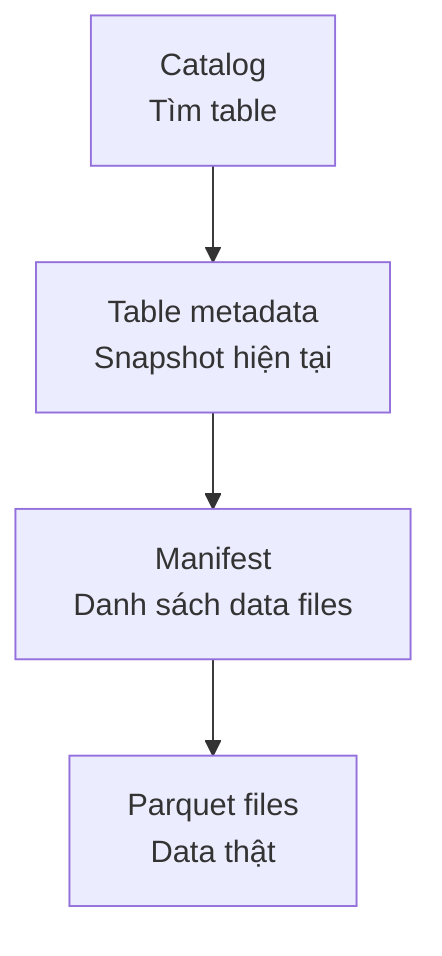

Parquet biết cách lưu column trong một file, nhưng không biết 8.000 file nào tạo thành version hiện tại của bảng `orders`. Nó cũng không tự điều phối hai writer đang commit cùng lúc.

**Table Format** (định dạng quản lý table) đặt một lớp metadata trên các data file để theo dõi snapshot, schema, partition và thay đổi của table.

## File format và table format làm hai việc

| Câu hỏi | File format | Table format |
| --- | --- | --- |
| Giá trị trong một file được mã hoá ra sao? | Có | Không |
| File nào thuộc table hiện tại? | Không | Có |
| Snapshot trước gồm file nào? | Không | Có |
| Commit đồng thời xử lý ra sao? | Không | Có |
| Column được nén thế nào? | Có | Không |

Iceberg, Delta Lake và Hudi đều giải quyết nhóm vấn đề này nhưng khác protocol, catalog integration, engine support và cách tối ưu update.

## Cách chọn

Đừng chọn từ bảng feature chung chung. Hãy kiểm tra:

1. Compute engine đang dùng hỗ trợ read/write đến mức nào?
2. Catalog và cloud environment tích hợp ra sao?
3. Workload chủ yếu append, update từ CDC hay streaming upsert?
4. Team có vận hành compaction và cleanup được không?
5. Tool khác có đọc đúng version và feature đang bật không?

Table format đem transaction, schema evolution và time travel đến object storage, nhưng không tự tạo Data Quality, governance hay data model tốt. Một thư mục Parquet append-only nhỏ có thể chưa cần nó. Khi nhiều writer, update/delete và lịch sử snapshot trở thành yêu cầu thật, lớp metadata này bắt đầu có giá trị.
