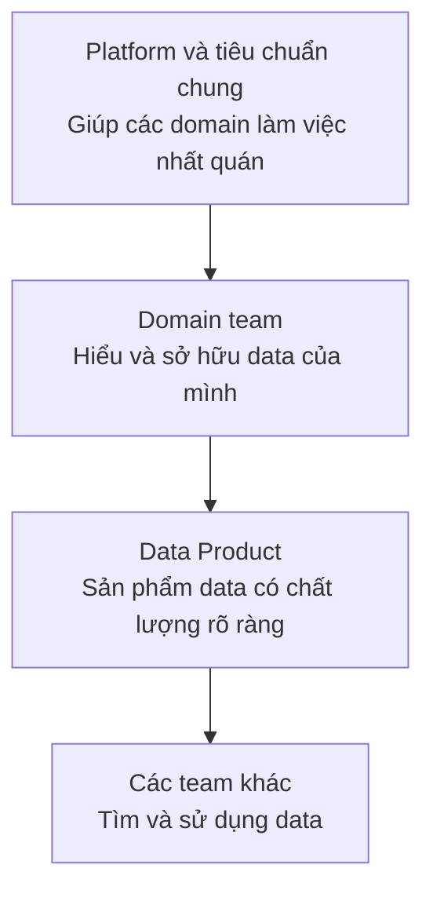

# Data Engineer trong Data Mesh

Phần này là kiến thức mở rộng. Người mới chưa cần hiểu Data Mesh để bắt đầu học Data Engineering.

Ở một công ty nhỏ, một data team trung tâm có thể quản lý tất cả pipeline và table. Khi công ty có nhiều mảng kinh doanh, team này dễ trở thành điểm nghẽn vì phải hiểu data của nhiều Domain (mảng nghiệp vụ) như đơn hàng, thanh toán và giao hàng cùng lúc.

Data Mesh (cách tổ chức data theo nhiều domain có quyền sở hữu rõ ràng) chia trách nhiệm đó cho các team gần với data nhất:

Ví dụ, Order team chịu trách nhiệm cho data đơn hàng, Payment team chịu trách nhiệm cho giao dịch, còn Delivery team chịu trách nhiệm cho data giao hàng. Mỗi team cung cấp một Data Product (sản phẩm data) có owner (team chịu trách nhiệm), tài liệu, quy tắc chất lượng và cách truy cập rõ ràng.

Vai trò của Data Engineer vì thế cũng thay đổi:

| Mô hình | Data Engineer thường làm gì? |
| --- | --- |
| Data team trung tâm | Xây pipeline và table cho nhiều mảng business |
| Domain team trong Data Mesh | Xây và vận hành Data Product của một domain |
| Platform team trong Data Mesh | Xây công cụ chung để các domain tự tạo và chia sẻ Data Product |

Data Mesh còn yêu cầu tiêu chuẩn chung về bảo mật, chất lượng và khả năng kết hợp data giữa các domain. Nó không phải một phần mềm có thể cài đặt, cũng không mặc nhiên phù hợp với mọi công ty lớn. Nếu một team trung tâm vẫn phục vụ tốt, Data Mesh có thể tạo thêm nhiều việc hơn giá trị.

Khái niệm này được Zhamak Dehghani trình bày chi tiết trong [Data Mesh Principles and Logical Architecture](https://martinfowler.com/articles/data-mesh-principles.html).

Quay lại: [Data Engineer là gì?]().

