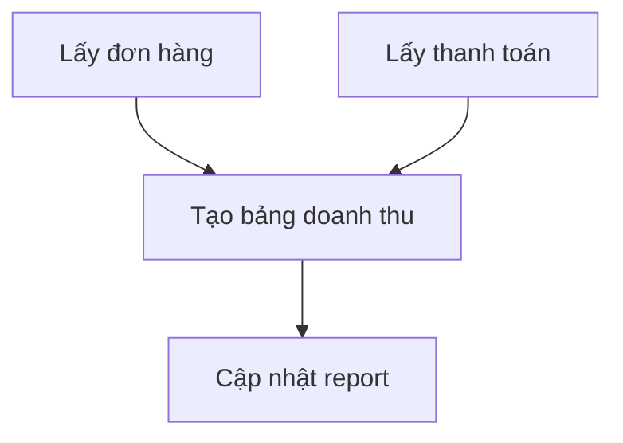

# Data Engineer xây những hệ thống gì?

Nếu Data Engineer là người xây hệ thống, vậy họ xây những hệ thống nào?

Câu trả lời tuỳ vào công ty. Một cửa hàng có vài nghìn đơn mỗi ngày không cần kiến trúc giống một ứng dụng đang phục vụ hàng triệu người. Tuy vậy, phần lớn hệ thống data đều được ghép từ những phần quen thuộc dưới đây.

## Một hệ thống nhỏ có thể triển khai thế nào?

Giả sử đội vận hành cần report trước 8 giờ sáng, mỗi ngày chỉ có vài nghìn đơn. Mình có thể bắt đầu bằng một chương trình Python chạy mỗi đêm: lấy data về, lưu vào PostgreSQL, chạy SQL rồi xuất kết quả cho Analyst.

Khi chia nhỏ công việc của chương trình đó, những tên gọi như ingestion hay orchestration sẽ dễ hình dung hơn:

| Thành phần | Triển khai trong ví dụ | Người vận hành chính | Đầu ra |
| --- | --- | --- | --- |
| Ingestion | Chương trình Python đọc API phân trang | DE, phối hợp Backend khi nguồn lỗi | File JSON gốc của đủ các trang |
| Storage | Thư mục raw và PostgreSQL riêng cho phân tích | DE quản lý bảng; người phụ trách hạ tầng quản lý sao lưu | Data gốc và bảng đã làm sạch |
| Transformation | File SQL chạy sau khi tải đủ nguồn | DE thống nhất metric với Analyst | Một row mỗi order và doanh thu ngày/khu vực |
| Orchestration | Một chương trình gọi tuần tự các bước, chạy theo lịch đêm | DE | Trạng thái từng bước; dừng khi bước trước lỗi |
| Serving | View SQL hoặc CSV cho Analyst | DE quản lý đầu ra; Analyst quản lý report | Report trước 08:00 |
| Monitoring | Log số row, thời gian, bước lỗi và thông báo lỗi | DE tiếp nhận, nhờ Backend nếu lỗi nguồn | Thông tin đủ để xử lý và chạy lại |

Nhìn bảng có vẻ nhiều phần, nhưng lúc đầu chúng có thể nằm trong cùng một chương trình. DE theo dõi chương trình đó; nếu API thiếu data thì trao đổi với Backend, còn nếu con số trên report chưa đúng ý nghĩa thì làm việc với Analyst.

## Hệ thống Data Ingestion

Data Ingestion (thu thập và đưa data vào hệ thống) kết nối Source System (hệ thống nguồn) với nơi lưu trữ dành cho data.

Trong hệ thống nhỏ ở trên, chương trình Python đọc đơn hàng và nhà hàng từ database ứng dụng, rồi lấy thanh toán và giao hàng từ API của hai hệ thống còn lại. Đầu ra đầu tiên là các file gốc, để nếu bước xử lý phía sau sai thì mình còn dữ liệu để kiểm tra lại.

Vì report chỉ cần vào sáng hôm sau, chương trình có thể chạy mỗi đêm. Nếu sau này đội vận hành muốn xem tình hình trong ngày, mình mới cân nhắc lấy data thường xuyên hơn.

Với bảng đơn hàng lớn, đọc lại từ đầu mỗi lần có thể khá chậm. Khi chỉ lấy phần mới hoặc vừa thay đổi, pipeline cần nhớ mình đã đọc đến đâu.

Nhưng bảng nhà hàng chỉ có vài chục row thì sao? Lấy lại toàn bộ, thường gọi là Full Load, vẫn hợp lý. Việc này không tự làm data bị trùng. Data bị trùng khi mình cứ thêm vào bảng đích mà không xử lý những row đã có.

Với PostgreSQL, một cách làm là tải danh sách nhà hàng vào bảng chuẩn bị `restaurants_staging`. Sau khi chắc chắn đã tải đủ và mã nhà hàng không trùng, mình thay dữ liệu cũ trong một transaction. Các lệnh bên trong phải cùng thành công thì thay đổi mới được lưu:

```sql
BEGIN;
DELETE FROM restaurants;
INSERT INTO restaurants (restaurant_id, restaurant_name, area)
SELECT restaurant_id, restaurant_name, area FROM restaurants_staging;
COMMIT;
```

Nếu nguồn có hai nhà hàng, chạy lần đầu hay lần thứ hai thì bảng đích vẫn có hai row. Nếu ghi lỗi trước `COMMIT`, chương trình gọi `ROLLBACK` để huỷ thay đổi và giữ bản cũ. Cách làm này dành cho bảng phân tích độc lập, chỉ có một job ghi và không có bảng khác đặt khoá ngoại trỏ vào. Bước tải nguồn phải hoàn tất trước khi bắt đầu thay dữ liệu.

## Hệ thống Data Storage

Data Storage (nơi lưu trữ data) không chỉ có một loại.

| Nơi lưu trữ | Dùng chủ yếu cho việc gì? | Ví dụ |
| --- | --- | --- |
| Database (cơ sở dữ liệu) | Giúp application đọc và ghi data khi người dùng thao tác | MySQL lưu đơn hàng |
| Data Warehouse (kho dữ liệu) | Lưu data đã được tổ chức để phân tích và làm report | Bảng doanh thu theo ngày |
| Data Lake (hồ dữ liệu) | Giữ nhiều data gốc, kể cả file và các định dạng khác nhau | File lịch sử đơn hàng |

Người mới thường nhầm Database và Data Warehouse vì cả hai đều có table và đều dùng SQL. Khác biệt nằm ở công việc chính: Database giúp application vận hành, còn Data Warehouse được thiết kế để phân tích data từ nhiều nguồn.

Với hệ thống đang xét, PostgreSQL riêng cho phân tích và thư mục lưu file gốc là đủ để bắt đầu. Khi nhu cầu truy vấn hoặc lượng data thay đổi, mình mới xem xét có cần chuyển sang một warehouse chuyên dụng hay không.

## Hệ thống Data Transformation

Data Transformation (biến đổi data) biến data gần với application thành data gần với câu hỏi business.

Trong Source System, một đơn hàng có thể nằm ở bốn bảng:

| Bảng nguồn | Data cần dùng |
| --- | --- |
| `orders` | Mã đơn và thời gian đặt |
| `payments` | Số tiền đã thanh toán |
| `restaurants` | Tên và khu vực nhà hàng |
| `deliveries` | Thời điểm giao thành công |

Hệ thống transformation ghép chúng thành một bảng dễ sử dụng hơn:

| order_id | order_date | restaurant | revenue | delivery_minutes |
| --- | --- | --- | ---: | ---: |
| ORD-1042 | 2026-09-06 | Cơm Nhà | 120,000 | 30 |

Đây vẫn là đơn 120,000 VND ở bài đầu: `order_date` lấy theo ngày tạo đơn ở Singapore, còn thời gian giao làm tròn đến phút. Để có cột `revenue`, DE và Analyst cần thống nhất đơn nào được tính doanh thu. Nếu mỗi report tự tính một kiểu, công ty sẽ có nhiều con số doanh thu cho cùng một ngày.

## Hệ thống Orchestration

Khi có một pipeline, bạn có thể tự chạy nó. Khi có nhiều pipeline phụ thuộc nhau, cần Orchestration (điều phối các bước xử lý).

Report chỉ nên được cập nhật sau khi data đơn hàng và thanh toán đã về đầy đủ:



Orchestration đảm bảo các bước chạy đúng thứ tự, ghi lại bước nào thất bại và cho phép chạy lại từ chỗ cần thiết. Airflow là một công cụ có thể làm việc này, nhưng người mới nên hiểu bài toán phụ thuộc trước khi học công cụ.

## Hệ thống Data Serving

Data Serving (đưa data cho người hoặc hệ thống sử dụng) là đoạn cuối của đường đi. Cùng bảng đơn hàng đã xử lý có thể phục vụ nhiều đầu ra:

| Người sử dụng | Đầu ra họ cần |
| --- | --- |
| Đội vận hành | Report đơn giao trễ theo nhà hàng |
| Đội tài chính | Bảng đối soát số tiền đã thanh toán |
| Quản lý | Dashboard doanh thu theo ngày |
| Application | Cảnh báo khi một đơn chờ quá lâu |

Nếu không biết ai sẽ sử dụng đầu ra, team rất dễ xây một hệ thống có nhiều công nghệ nhưng không giải quyết được câu hỏi nào.

## Hệ thống theo dõi và bảo vệ data

Các phần phía trên chỉ hữu ích khi chúng tiếp tục hoạt động. Monitoring (theo dõi hệ thống) và Data Quality (chất lượng data) giúp team phát hiện vấn đề trước khi người dùng nhìn thấy một report sai.

| Câu hỏi cần theo dõi | Vấn đề có thể xảy ra |
| --- | --- |
| Pipeline có chạy đúng giờ không? | Report hôm nay vẫn đang dùng data hôm qua |
| Số row có giảm bất thường không? | Một Source System chưa gửi đủ data |
| Có `order_id` bị trùng không? | Pipeline đã sao chép cùng một đơn nhiều lần |
| Ai được xem thông tin khách hàng? | Data cá nhân bị truy cập sai mục đích |
| Hệ thống đang tốn bao nhiêu tiền? | Một pipeline chạy đúng nhưng quá đắt |

Phân quyền, bảo mật, lịch sử thay đổi và chi phí thường ít xuất hiện trong demo. Khi hệ thống đi vào production, chúng trở thành một phần của công việc.

## Streaming có phải lúc nào cũng cần không?

Streaming (xử lý data liên tục khi data xuất hiện) phù hợp khi kết quả cần được cập nhật trong vài giây, chẳng hạn vị trí tài xế trên bản đồ. Report doanh thu cuối ngày có thể chỉ cần pipeline chạy theo lịch.

| Nhu cầu | Cách đơn giản phù hợp |
| --- | --- |
| Report doanh thu mỗi sáng | Pipeline chạy một lần mỗi đêm |
| Dashboard vận hành cập nhật mỗi 15 phút | Pipeline chạy mỗi 15 phút |
| Vị trí tài xế trên bản đồ | Streaming |

Không cần chọn Streaming chỉ vì nó nghe hiện đại hơn. Hệ thống đơn giản nhất đáp ứng được thời gian người dùng cần thường là lựa chọn dễ xây và dễ vận hành hơn.

## Tóm lại

Data Engineer có thể làm việc với Data Ingestion, Data Storage, Data Transformation, Orchestration, Data Serving và hệ thống theo dõi. Không phải Data Engineer nào cũng tự xây tất cả những phần này, nhưng họ cần hiểu data đi qua chúng như thế nào.

Điểm bắt đầu không phải là chọn thật nhiều công nghệ. Hãy bắt đầu bằng ba câu hỏi: data đến từ đâu, ai cần dùng nó và họ cần nó vào lúc nào.

Nhưng ai quyết định report cần gì, và ai giải thích data ở nguồn? Bài [Một data team làm việc với nhau như thế nào?]() sẽ tiếp tục câu chuyện đó.

