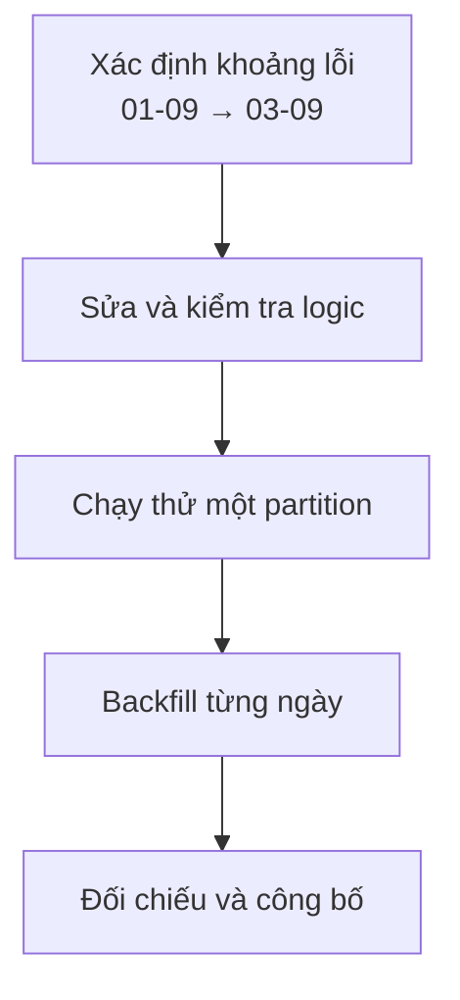

# Sửa lại data trong quá khứ với Backfill

Pipeline bỏ sót thanh toán từ ngày 1 đến ngày 3 vì một filter sai. Sau khi sửa code, data hôm nay đúng nhưng ba ngày lịch sử vẫn thiếu.

**Backfill** (xử lý bù data lịch sử) là chạy logic cho một khoảng quá khứ để tạo phần output bị thiếu hoặc cập nhật kết quả theo logic mới.



## Job phải nhận khoảng data rõ ràng

```bash
transform_orders --start-date 2026-09-01 --end-date 2026-09-04
```

Không nên dùng “hôm qua” nằm cứng trong code. Một lần chạy ngày 9 vẫn phải tạo đúng partition ngày 1 khi được yêu cầu.

| Partition | Trước | Sau backfill |
| --- | ---: | ---: |
| 2026-09-01 | 81,204 | 102,118 |
| 2026-09-02 | 79,884 | 101,732 |
| 2026-09-03 | 80,105 | 103,041 |

## Backfill có thể gây ảnh hưởng production

Đọc ba năm data cùng lúc có thể chiếm hết compute, làm chậm job hằng ngày và gửi nhiều update đến downstream. Hãy chia theo partition, giới hạn số job song song và ưu tiên pipeline hiện tại.

Trước khi chạy cần biết:

- Input lịch sử còn đủ không?
- Code mới có tương thích schema cũ không?
- Output được thay an toàn hay sẽ duplicate?
- Dashboard và notification có phản ứng với update cũ không?
- Có cách so sánh trước và sau không?

Backfill kết thúc khi data đã được kiểm tra, không chỉ khi job hiện màu xanh. Hãy đối chiếu row count, tổng tiền, khoảng thời gian và một mẫu order với Source System.

