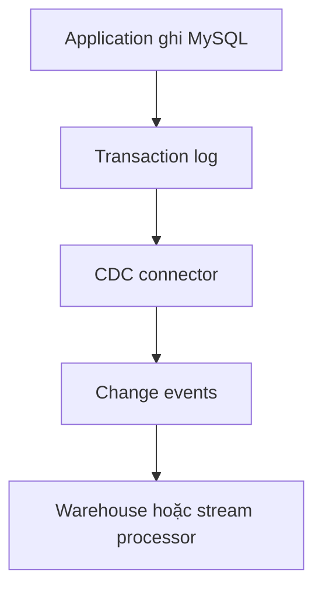

# Theo dõi thay đổi trong Database với CDC

Bảng `orders` có hàng trăm triệu row. Query lại toàn bảng mỗi năm phút vừa chậm vừa tạo tải lớn, nhưng pipeline vẫn cần biết order nào vừa đổi trạng thái.

**Change Data Capture** (thu thập thay đổi dữ liệu), thường viết là **CDC**, lấy các thao tác Insert, Update và Delete rồi chuyển chúng đến hệ thống khác.



Một update có thể được biểu diễn:

```json
{
  "operation": "update",
  "key": {"order_id": "ORD-1042"},
  "before": {"status": "paid"},
  "after": {"status": "delivered"}
}
```

## Vì sao transaction log hữu ích?

Database đã ghi log để duy trì transaction và phục hồi. Đọc log cho phép bắt cả Delete và nhiều update liên tiếp mà query `updated_at` có thể bỏ qua. Nó cũng tránh chạy query quét lớn thường xuyên.

## Snapshot rồi mới theo thay đổi

CDC thường bắt đầu bằng snapshot hiện trạng, sau đó tiếp tục từ một vị trí trong log. Nếu vị trí giữa hai bước sai, pipeline có thể tạo khoảng trống hoặc duplicate. Consumer phải lưu offset và xử lý event lặp lại an toàn.

Schema thay đổi, log retention quá ngắn, transaction lớn và quyền truy cập là các vấn đề vận hành thật. CDC cũng không tự tạo bảng phân tích: nó sao chép thay đổi gần với Source System; downstream vẫn cần Transformation và Data Quality.

Với bảng nhỏ cập nhật theo giờ, query incremental đơn giản có thể tốt hơn. CDC có giá trị khi cần update/delete nhanh, volume thay đổi lớn hoặc muốn giảm query lên database nguồn.

