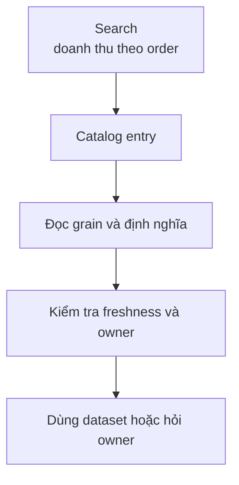

# Tìm đúng data với Data Catalog

Một Analyst tìm “doanh thu” và thấy `orders_revenue`, `daily_revenue_v2`, `finance_revenue_final` cùng sáu bảng khác. Tên bảng không đủ để chọn.

**Data Catalog** (danh mục dữ liệu) là nơi giúp người dùng khám phá dataset và đọc context cần thiết để sử dụng nó.

Một entry hữu ích có thể hiển thị:

| Thông tin | Ví dụ |
| --- | --- |
| Tên | `finance.fact_orders` |
| Mô tả | Một row cho mỗi order đã thanh toán |
| Owner | Finance Data |
| Freshness | Mỗi 15 phút |
| Quality | 12/12 checks đạt |
| Classification | Internal |
| Lineage | Từ `raw_orders`, `raw_payments` |
| Trạng thái | Certified |

Catalog không chỉ là ô tìm kiếm. Nếu metadata nghèo, kết quả tìm kiếm vẫn là danh sách tên khó hiểu. Nếu catalog không nằm trong workflow hằng ngày, mô tả nhanh chóng lỗi thời.

## Certification và deprecation

Team có thể đánh dấu dataset đã được review là **Certified** (được xác nhận để dùng cho mục đích nêu rõ). Bảng sắp bỏ cần trạng thái **Deprecated**, ngày ngừng và bảng thay thế.

Không nên hiểu Certified là đúng cho mọi câu hỏi. `fact_orders` phù hợp tính order revenue có thể không phù hợp tính dòng tiền đã settled.

Catalog có giá trị khi giảm thời gian hỏi “data nằm đâu?”, giúp người dùng tránh bảng cũ và chỉ đúng owner khi cần làm rõ. Hãy bắt đầu với những dataset nhiều người dùng, không phải số lượng entry lớn.

