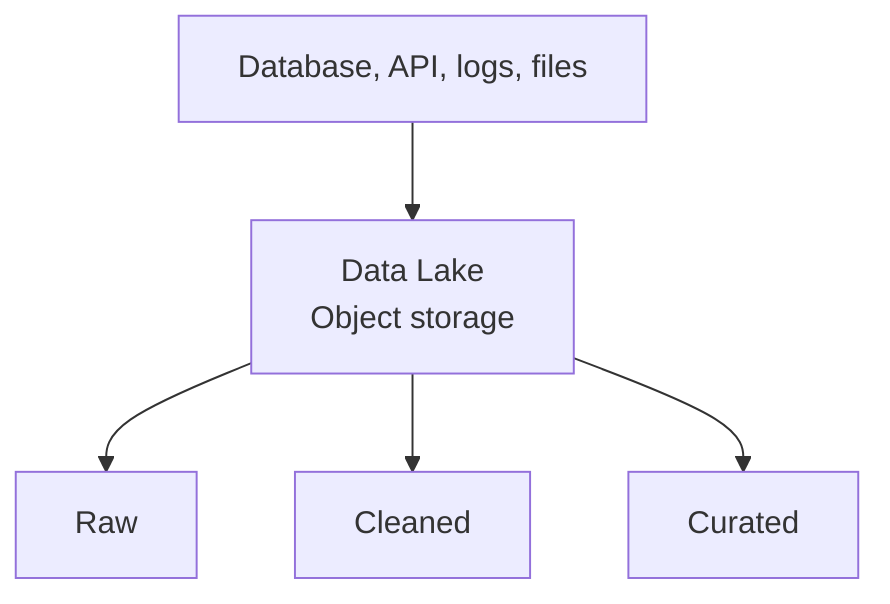

# Lưu raw data ở quy mô lớn với Data Lake

Công ty muốn giữ log ứng dụng, JSON từ đối tác, ảnh biên nhận và lịch sử order nhiều năm. Đưa mọi thứ vào bảng warehouse có thể đắt hoặc không phù hợp.

**Data Lake** (hồ dữ liệu) lưu data ở quy mô lớn, thường trên object storage, với nhiều định dạng và mức xử lý khác nhau.



Một layout đơn giản:

```text
/orders/raw/ingest_date=2026-09-08/part-001.json
/orders/clean/order_date=2026-09-08/part-001.parquet
```

## Data Lake khác Data Warehouse ở đâu?

| Data Lake | Data Warehouse |
| --- | --- |
| Lưu file/object nhiều định dạng | Tổ chức quanh table để query |
| Có thể giữ raw data rẻ | Thường phục vụ analytical workload trực tiếp |
| Schema có thể được áp dụng khi đọc | Schema và constraint được quản lý chặt hơn |
| Cần engine khác để xử lý/query | Engine query là phần cốt lõi |

Ranh giới ngày càng mờ vì warehouse đọc object storage và lake có table format. Điều quan trọng là khả năng hệ thống thật, không phải nhãn marketing.

## Hồ data có thể thành nơi khó dùng

Nếu file không có owner, schema, partition convention hoặc retention, người dùng không biết data nào tin được. Small files làm query chậm; quyền bucket quá rộng làm lộ data; xoá nhầm path có thể phá nhiều bảng.

Data Lake phù hợp khi cần giữ raw data lớn, nhiều định dạng, chia sẻ cho nhiều engine hoặc tách compute khỏi storage. Một team chỉ có các bảng phân tích có cấu trúc có thể bắt đầu bằng Data Warehouse đơn giản hơn.

