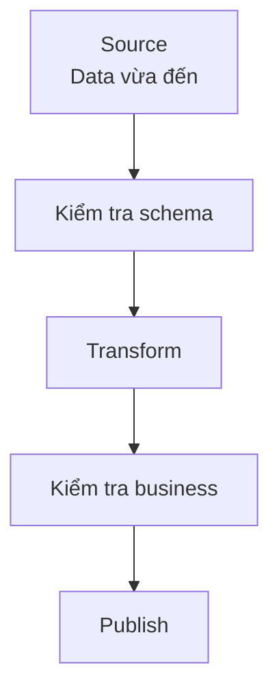

# Data Quality: làm sao biết data đủ tin cậy?

Pipeline chạy thành công và dashboard mở được. Nhưng doanh thu hôm nay bằng không vì `payment_status` vừa đổi từ `paid` thành `PAID`. Không có error kỹ thuật; data sai về ý nghĩa.

**Data Quality** (chất lượng dữ liệu) cho biết data có đủ phù hợp cho một mục đích cụ thể hay không. Thay vì nói “data phải sạch”, team viết điều kiện có thể kiểm tra.

## Chất lượng phụ thuộc cách dùng

Địa chỉ thiếu số căn hộ có thể đủ cho report theo khu vực nhưng không đủ để giao hàng. Cùng dataset có thể đạt yêu cầu này và không đạt yêu cầu khác.

Với `fact_orders`, team tài chính có thể cần:

| Điều kiện | Vì sao? |
| --- | --- |
| `order_id` không rỗng | Order phải nhận diện được |
| `order_id` duy nhất | Không tính doanh thu hai lần |
| `net_amount >= 0` | Giá trị âm cần quy tắc riêng |
| `status` thuộc danh sách | Không bỏ qua status mới |
| Data hôm qua có trước 07:00 | Kịp giờ đối soát |

Đây là Completeness, Uniqueness, Validity và Timeliness. Tên nhóm ít quan trọng hơn việc check bắt đúng rủi ro.

## Check từng row

```sql
SELECT * FROM fact_orders
WHERE order_id IS NULL
   OR net_amount < 0
   OR status NOT IN ('created', 'paid', 'delivered', 'cancelled');
```

Nếu query trả row, pipeline có thể dừng batch, cách ly row lỗi hoặc cảnh báo rồi tiếp tục theo chính sách đã thống nhất. Không nên âm thầm xoá row lỗi vì tổng số order sẽ có vẻ hợp lệ dù data bị mất.

## Check cả dataset

Mọi row có thể hợp lệ nhưng pipeline chỉ lấy được một nửa data.

| Check | Hôm qua | Hôm nay | Đánh giá |
| --- | ---: | ---: | --- |
| Tổng row | 102,430 | 51,018 | Bất thường |
| `order_id` rỗng | 0% | 0% | Đạt |
| Thời điểm mới nhất | 23:59 | 12:01 | Chưa đủ |

```text
Nếu row_count hôm nay < 70% trung vị 7 ngày gần nhất
→ không công bố bảng và gửi cảnh báo
```

Ngưỡng không phải chân lý. Ngày lễ có thể làm volume đổi mạnh, nên rule cần phản ánh hành vi business.

## Đặt check vào đúng chỗ



Check sớm giúp khoanh vùng lỗi; check output xác nhận thứ người dùng thực sự nhận. Pipeline quan trọng thường cần cả hai.

Alert nên cho biết bảng, partition, rule, giá trị thực tế, ngưỡng và owner. Nếu không ai biết phải làm gì khi check fail, check đó chưa hoàn chỉnh.

Không thể kiểm tra mọi thứ. Hãy bắt đầu từ bảng quan trọng và lỗi từng gây tác động: duplicate key, thiếu partition, data đến muộn, giá trị ngoài domain và metric đổi bất thường. Một số check gắn với quyết định thật có giá trị hơn hàng trăm check không ai xử lý.

