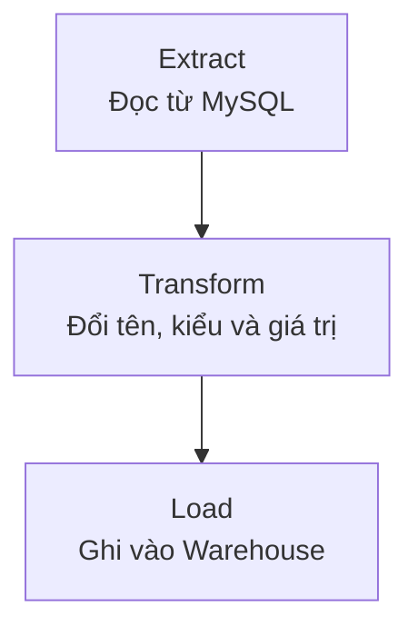
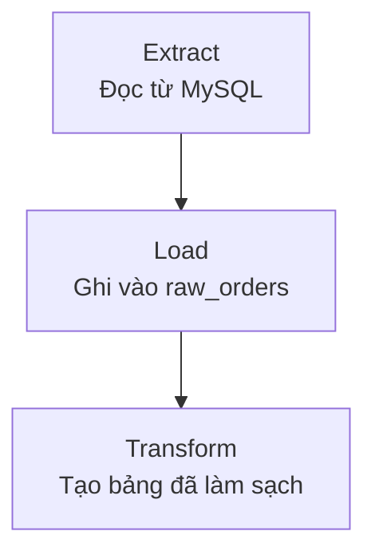

# ETL và ELT khác nhau thế nào?

Data đơn hàng đã được lấy khỏi MySQL, nhưng cấu trúc vẫn phục vụ application. Trước khi tính doanh thu, team phải làm sạch và ghép nó với thanh toán.

- **Extract**: đọc data từ Source System.
- **Transform**: làm sạch, kiểm tra, đổi cấu trúc hoặc tính thêm field.
- **Load**: ghi data vào nơi đích.

**ETL** đi theo Extract → Transform → Load. **ELT** đi theo Extract → Load → Transform. Khác biệt chính là data được biến đổi trước hay sau khi vào hệ thống đích.

## Cùng một row, hai đường đi

| id | total_cents | status | created_at |
| --- | ---: | --- | --- |
| ORD-1042 | 120000 | DELIVERED | 2026-09-08T12:02:10+08:00 |

Team muốn output:

| order_id | total_amount | status | order_date |
| --- | ---: | --- | --- |
| ORD-1042 | 1200.00 | delivered | 2026-09-08 |

Với ETL:



Với ELT:



```sql
SELECT
  id AS order_id,
  total_cents / 100.0 AS total_amount,
  LOWER(status) AS status,
  CAST(created_at AS DATE) AS order_date
FROM raw_orders;
```

## Khi nào ETL hợp lý?

ETL hữu ích khi data phải được xử lý trước khi đến đích. Ví dụ, pipeline phải loại số thẻ thanh toán đầy đủ trước bước Load. Nó cũng phù hợp khi hệ thống đích không đủ khả năng Transform.

Nếu chỉ giữ data đã Transform, team có thể mất thông tin gốc cần cho yêu cầu mới. Xử lý lại lịch sử cũng khó hơn nếu raw data không còn.

## Khi nào ELT hợp lý?

Data Warehouse hiện đại có thể lưu nhiều data và chạy Transformation lớn. ELT cho phép giữ raw data để kiểm tra, viết Transformation bằng SQL và tạo nhiều output từ cùng một nguồn.

Load trước không có nghĩa đưa mọi data vào không kiểm soát. Quyền truy cập, dữ liệu cá nhân, chi phí và thời gian lưu giữ vẫn cần quyết định rõ.

## Hệ thống thật có thể dùng cả hai

Pipeline có thể giải nén file và che dữ liệu nhạy cảm trước khi Load, rồi dùng SQL trong warehouse để tạo bảng report. Thay vì hỏi cách nào luôn tốt hơn, hãy hỏi:

1. Data nào được phép đi vào đích?
2. Có cần giữ bản gốc để xử lý lại không?
3. Nơi nào đủ khả năng chạy Transformation?
4. Ai cần đọc và thay đổi logic?
5. Nếu Transformation lỗi, data đã Load có bị dùng nhầm không?

ETL và ELT mô tả thứ tự. Pipeline tốt còn phải chạy lại an toàn, quan sát được và kiểm tra chất lượng output.

