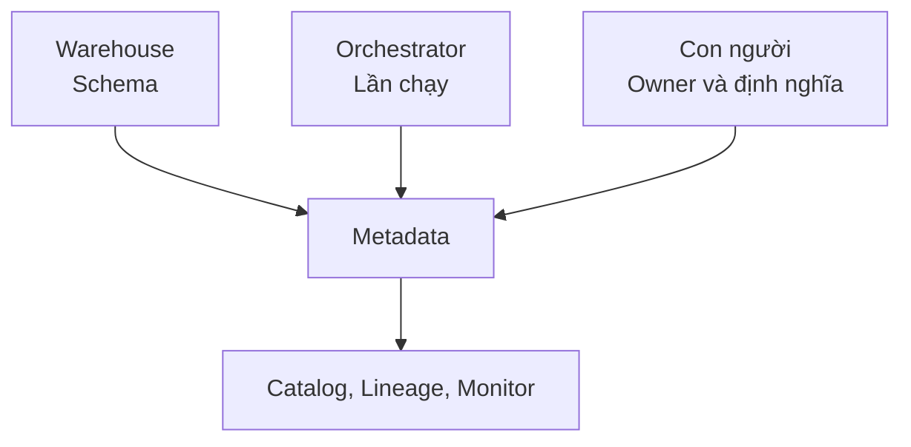

# Metadata: data để hiểu data

Warehouse có bảng `fact_orders`, nhưng tên bảng không cho biết một row đại diện cho gì, cập nhật lúc nào hay ai chịu trách nhiệm.

**Metadata** (data mô tả data) cung cấp context để con người và hệ thống hiểu, tìm và vận hành một dataset.

| Nhóm | Ví dụ |
| --- | --- |
| Technical metadata | Tên field, type, partition, kích thước |
| Operational metadata | Lần cập nhật cuối, thời gian chạy, số row |
| Business metadata | Định nghĩa revenue, grain, cách sử dụng |
| Ownership metadata | Team và kênh liên hệ |
| Security metadata | Mức nhạy cảm, quyền truy cập |

Ví dụ tối thiểu cho `fact_orders`:

```yaml
name: fact_orders
grain: one row per order
owner: data-platform
freshness: every 15 minutes
primary_key: order_id
contains_pii: false
```

## Metadata đến từ đâu?

Schema có thể lấy tự động từ warehouse. Thời gian chạy đến từ orchestrator. Owner và định nghĩa business cần con người xác nhận. Tự động thu thập giảm công sức nhưng không thể tự đoán `net_revenue` có trừ voucher hay không.



Metadata cũ còn nguy hiểm hơn metadata thiếu vì tạo cảm giác tin cậy sai. Hãy gắn việc cập nhật owner và mô tả vào quy trình thay đổi dataset, đồng thời tự động hoá những field máy có thể xác nhận.

Metadata là nguyên liệu cho Data Catalog và Data Lineage. Catalog giúp tìm và hiểu data; Lineage dùng quan hệ giữa các dataset để theo dấu đường đi.

